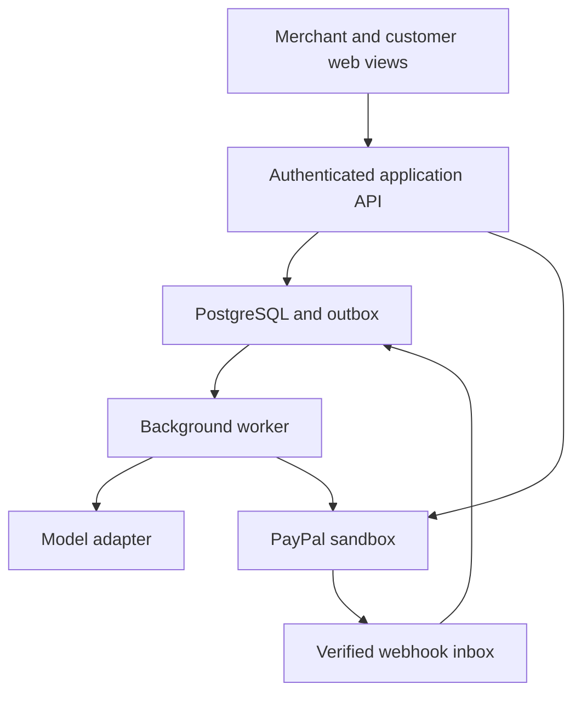

# Architecture and application API

## Selected implementation approach

TypeScript React/Next.js application, PostgreSQL as authoritative store, private object storage for attachments, a worker for model tasks and payment recovery, one AI provider through an adapter, PayPal REST APIs, and Render hosting. Start with a modular monolith; generated code volume does not justify microservices.

Pin dependency versions after checking installed/current official documentation. Use schema validation at every external boundary. Render is the only optional sponsor infrastructure currently selected. APIMatic and Postman are development aids, not customer features.

## Module boundaries

`domain/`: revisions, policies, readiness and money, independent of UI/provider.
`application/`: authorized use cases and transaction orchestration.
`integrations/paypal/`: typed provider calls and response mapping.
`integrations/ai/`: structured proposal extraction with citations.
`persistence/`: tenant-scoped repositories, migrations, locks and outbox.
`ui/`: merchant review, customer portal and job sheet.
`workers/`: retries, reconciliation, attachment processing and notifications.

## Proposed HTTP contract

| Method and route | Behavior |
| --- | --- |
| POST /api/jobs | Create merchant-owned original draft |
| GET /api/jobs/:id | Authorized scoped view |
| POST /api/jobs/:id/messages | Store supplied source; enqueue analysis |
| POST /api/jobs/:id/changes/:changeId/review | Merchant confirms/rejects patch; expectedVersion required |
| POST /api/jobs/:id/revisions | Create immutable proposal from reviewed patch |
| POST /api/jobs/:id/revisions/:revisionId/publish | Publish reviewed terms and invite customer |
| POST /api/reviews/:id/decision | Record approve/decline on exact revision/hash |
| POST /api/obligations/:id/checkout | Create/retrieve one reserved PayPal checkout operation |
| POST /api/payment-operations/:id/capture | Verify session, state and provider order before capture |
| POST /api/paypal/webhook | Verify, deduplicate, persist and enqueue |
| POST /api/jobs/:id/release | Merchant action after readiness checks |
| POST /api/jobs/:id/start | Record start; late changes require exception handling |
| POST /api/captures/:id/refunds | Merchant-reviewed, bounded refund operation |
| GET /api/jobs/:id/fulfillment | Current version and readiness; no private payment credentials |

All writes require authentication/authorization, CSRF protection where cookie-based, schema checks and stable operation identifiers. Return 409 for stale state, 422 for invalid proposals, 403 for access violations. Never accept client-supplied totals or seller IDs as authoritative.

## Existing code

As inspected October 20, 2026, `origin/feat/speclock-mvp` contains Next.js/React scaffolding, money helpers, PayPal HTTP integration, AI extraction and tests. It uses a file-backed store with process-local locks and an AUTHORIZE/partial-capture/QC model.

Potential reuse after review: money formatting/tests, provider HTTP error handling, environment conventions, UI shell and schema validation patterns.

Replace: process-local/file persistence, deal state model, vision QC/mandates, automatic balance release, one authorization split into later captures, and the assumption that all orders use NO_SHIPPING. Pact uses independent CAPTURE checkouts and appropriate shipping information for physical goods.

No code was ported or tested on this documentation branch. Implementation should selectively port reviewed modules; do not merge all legacy behavior by default. Read the old branch's AGENTS.md when porting framework files.

## Scaling

Database constraints and durable operation recovery precede multiple instances. Stateless web instances and job queues can scale independently. Bound model context to current scope and relevant sources, cache immutable extraction by content hash, and use deterministic rules before AI. Track latency/cost per resolved amendment. New domains add templates and evaluation cases, not separate payment engines. Integrations and customer onboarding are likely harder than throughput; this is a hypothesis to validate.
